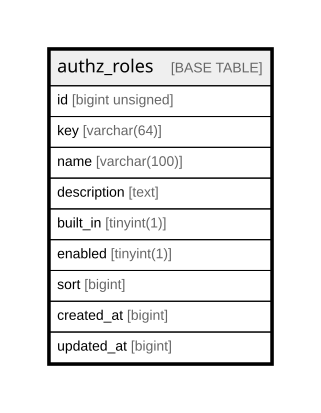

# authz_roles

## Description

<details>
<summary><strong>Table Definition</strong></summary>

```sql
CREATE TABLE `authz_roles` (
  `id` bigint unsigned NOT NULL AUTO_INCREMENT,
  `key` varchar(64) COLLATE utf8mb4_unicode_ci NOT NULL,
  `name` varchar(100) COLLATE utf8mb4_unicode_ci NOT NULL,
  `description` text COLLATE utf8mb4_unicode_ci,
  `built_in` tinyint(1) DEFAULT NULL,
  `enabled` tinyint(1) DEFAULT NULL,
  `sort` bigint DEFAULT NULL,
  `created_at` bigint DEFAULT NULL,
  `updated_at` bigint DEFAULT NULL,
  PRIMARY KEY (`id`),
  UNIQUE KEY `idx_authz_roles_key` (`key`)
) ENGINE=InnoDB AUTO_INCREMENT=[Redacted by tbls] DEFAULT CHARSET=utf8mb4 COLLATE=utf8mb4_unicode_ci
```

</details>

## Columns

| Name | Type | Default | Nullable | Extra Definition | Children | Parents | Comment |
| ---- | ---- | ------- | -------- | ---------------- | -------- | ------- | ------- |
| id | bigint unsigned |  | false | auto_increment |  |  |  |
| key | varchar(64) |  | false |  |  |  |  |
| name | varchar(100) |  | false |  |  |  |  |
| description | text |  | true |  |  |  |  |
| built_in | tinyint(1) |  | true |  |  |  |  |
| enabled | tinyint(1) |  | true |  |  |  |  |
| sort | bigint |  | true |  |  |  |  |
| created_at | bigint |  | true |  |  |  |  |
| updated_at | bigint |  | true |  |  |  |  |

## Constraints

| Name | Type | Definition |
| ---- | ---- | ---------- |
| idx_authz_roles_key | UNIQUE | UNIQUE KEY idx_authz_roles_key (key) |
| PRIMARY | PRIMARY KEY | PRIMARY KEY (id) |

## Indexes

| Name | Definition |
| ---- | ---------- |
| PRIMARY | PRIMARY KEY (id) USING BTREE |
| idx_authz_roles_key | UNIQUE KEY idx_authz_roles_key (key) USING BTREE |

## Relations



---

> Generated by [tbls](https://github.com/k1LoW/tbls)
