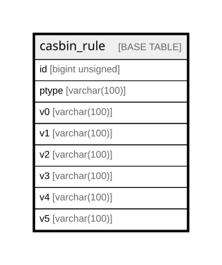

# casbin_rule

## Description

<details>
<summary><strong>Table Definition</strong></summary>

```sql
CREATE TABLE `casbin_rule` (
  `id` bigint unsigned NOT NULL AUTO_INCREMENT,
  `ptype` varchar(100) COLLATE utf8mb4_unicode_ci DEFAULT NULL,
  `v0` varchar(100) COLLATE utf8mb4_unicode_ci DEFAULT NULL,
  `v1` varchar(100) COLLATE utf8mb4_unicode_ci DEFAULT NULL,
  `v2` varchar(100) COLLATE utf8mb4_unicode_ci DEFAULT NULL,
  `v3` varchar(100) COLLATE utf8mb4_unicode_ci DEFAULT NULL,
  `v4` varchar(100) COLLATE utf8mb4_unicode_ci DEFAULT NULL,
  `v5` varchar(100) COLLATE utf8mb4_unicode_ci DEFAULT NULL,
  PRIMARY KEY (`id`),
  UNIQUE KEY `idx_casbin_rule_unique` (`ptype`,`v0`,`v1`,`v2`,`v3`,`v4`,`v5`),
  KEY `idx_casbin_rule` (`ptype`,`v0`,`v1`,`v2`,`v3`,`v4`,`v5`)
) ENGINE=InnoDB AUTO_INCREMENT=[Redacted by tbls] DEFAULT CHARSET=utf8mb4 COLLATE=utf8mb4_unicode_ci
```

</details>

## Columns

| Name | Type | Default | Nullable | Extra Definition | Children | Parents | Comment |
| ---- | ---- | ------- | -------- | ---------------- | -------- | ------- | ------- |
| id | bigint unsigned |  | false | auto_increment |  |  |  |
| ptype | varchar(100) |  | true |  |  |  |  |
| v0 | varchar(100) |  | true |  |  |  |  |
| v1 | varchar(100) |  | true |  |  |  |  |
| v2 | varchar(100) |  | true |  |  |  |  |
| v3 | varchar(100) |  | true |  |  |  |  |
| v4 | varchar(100) |  | true |  |  |  |  |
| v5 | varchar(100) |  | true |  |  |  |  |

## Constraints

| Name | Type | Definition |
| ---- | ---- | ---------- |
| idx_casbin_rule_unique | UNIQUE | UNIQUE KEY idx_casbin_rule_unique (ptype, v0, v1, v2, v3, v4, v5) |
| PRIMARY | PRIMARY KEY | PRIMARY KEY (id) |

## Indexes

| Name | Definition |
| ---- | ---------- |
| idx_casbin_rule | KEY idx_casbin_rule (ptype, v0, v1, v2, v3, v4, v5) USING BTREE |
| PRIMARY | PRIMARY KEY (id) USING BTREE |
| idx_casbin_rule_unique | UNIQUE KEY idx_casbin_rule_unique (ptype, v0, v1, v2, v3, v4, v5) USING BTREE |

## Relations



---

> Generated by [tbls](https://github.com/k1LoW/tbls)
