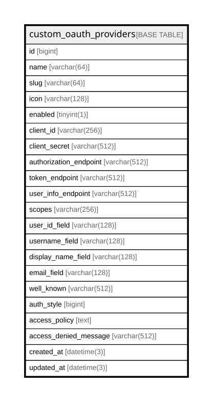

# custom_oauth_providers

## Description

<details>
<summary><strong>Table Definition</strong></summary>

```sql
CREATE TABLE `custom_oauth_providers` (
  `id` bigint NOT NULL AUTO_INCREMENT,
  `name` varchar(64) COLLATE utf8mb4_unicode_ci NOT NULL,
  `slug` varchar(64) COLLATE utf8mb4_unicode_ci NOT NULL,
  `icon` varchar(128) COLLATE utf8mb4_unicode_ci DEFAULT '',
  `enabled` tinyint(1) DEFAULT '0',
  `client_id` varchar(256) COLLATE utf8mb4_unicode_ci DEFAULT NULL,
  `client_secret` varchar(512) COLLATE utf8mb4_unicode_ci DEFAULT NULL,
  `authorization_endpoint` varchar(512) COLLATE utf8mb4_unicode_ci DEFAULT NULL,
  `token_endpoint` varchar(512) COLLATE utf8mb4_unicode_ci DEFAULT NULL,
  `user_info_endpoint` varchar(512) COLLATE utf8mb4_unicode_ci DEFAULT NULL,
  `scopes` varchar(256) COLLATE utf8mb4_unicode_ci DEFAULT 'openid profile email',
  `user_id_field` varchar(128) COLLATE utf8mb4_unicode_ci DEFAULT 'sub',
  `username_field` varchar(128) COLLATE utf8mb4_unicode_ci DEFAULT 'preferred_username',
  `display_name_field` varchar(128) COLLATE utf8mb4_unicode_ci DEFAULT 'name',
  `email_field` varchar(128) COLLATE utf8mb4_unicode_ci DEFAULT 'email',
  `well_known` varchar(512) COLLATE utf8mb4_unicode_ci DEFAULT NULL,
  `auth_style` bigint DEFAULT '0',
  `access_policy` text COLLATE utf8mb4_unicode_ci,
  `access_denied_message` varchar(512) COLLATE utf8mb4_unicode_ci DEFAULT NULL,
  `created_at` datetime(3) DEFAULT NULL,
  `updated_at` datetime(3) DEFAULT NULL,
  PRIMARY KEY (`id`),
  UNIQUE KEY `idx_custom_oauth_providers_slug` (`slug`)
) ENGINE=InnoDB DEFAULT CHARSET=utf8mb4 COLLATE=utf8mb4_unicode_ci
```

</details>

## Columns

| Name | Type | Default | Nullable | Extra Definition | Children | Parents | Comment |
| ---- | ---- | ------- | -------- | ---------------- | -------- | ------- | ------- |
| id | bigint |  | false | auto_increment |  |  |  |
| name | varchar(64) |  | false |  |  |  |  |
| slug | varchar(64) |  | false |  |  |  |  |
| icon | varchar(128) |  | true |  |  |  |  |
| enabled | tinyint(1) | 0 | true |  |  |  |  |
| client_id | varchar(256) |  | true |  |  |  |  |
| client_secret | varchar(512) |  | true |  |  |  |  |
| authorization_endpoint | varchar(512) |  | true |  |  |  |  |
| token_endpoint | varchar(512) |  | true |  |  |  |  |
| user_info_endpoint | varchar(512) |  | true |  |  |  |  |
| scopes | varchar(256) | openid profile email | true |  |  |  |  |
| user_id_field | varchar(128) | sub | true |  |  |  |  |
| username_field | varchar(128) | preferred_username | true |  |  |  |  |
| display_name_field | varchar(128) | name | true |  |  |  |  |
| email_field | varchar(128) | email | true |  |  |  |  |
| well_known | varchar(512) |  | true |  |  |  |  |
| auth_style | bigint | 0 | true |  |  |  |  |
| access_policy | text |  | true |  |  |  |  |
| access_denied_message | varchar(512) |  | true |  |  |  |  |
| created_at | datetime(3) |  | true |  |  |  |  |
| updated_at | datetime(3) |  | true |  |  |  |  |

## Constraints

| Name | Type | Definition |
| ---- | ---- | ---------- |
| idx_custom_oauth_providers_slug | UNIQUE | UNIQUE KEY idx_custom_oauth_providers_slug (slug) |
| PRIMARY | PRIMARY KEY | PRIMARY KEY (id) |

## Indexes

| Name | Definition |
| ---- | ---------- |
| PRIMARY | PRIMARY KEY (id) USING BTREE |
| idx_custom_oauth_providers_slug | UNIQUE KEY idx_custom_oauth_providers_slug (slug) USING BTREE |

## Relations



---

> Generated by [tbls](https://github.com/k1LoW/tbls)
