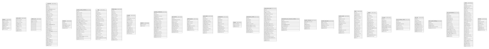

# new-api

## Tables

| Name | Columns | Comment | Type |
| ---- | ------- | ------- | ---- |
| [abilities](abilities.md) | 7 | 模型路由表(模型↔渠道↔分组)。决定模型能不能用、走哪个渠道。加渠道时后端自动生成,不用手填。 | BASE TABLE |
| [authz_roles](authz_roles.md) | 9 |  | BASE TABLE |
| [casbin_rule](casbin_rule.md) | 8 |  | BASE TABLE |
| [channels](channels.md) | 30 |  | BASE TABLE |
| [checkins](checkins.md) | 5 |  | BASE TABLE |
| [custom_oauth_providers](custom_oauth_providers.md) | 21 |  | BASE TABLE |
| [enhance_costs](enhance_costs.md) | 13 | MediaKit 超分花费（人民币分，对账用）。 | BASE TABLE |
| [logs](logs.md) | 21 |  | BASE TABLE |
| [midjourneys](midjourneys.md) | 22 |  | BASE TABLE |
| [models](models.md) | 13 | 模型展示元数据。每行一个模型:图标/描述/厂商。不含价格——价格在 options.ModelRatio。 | BASE TABLE |
| [options](options.md) | 2 | 全局配置(key-value)。存所有价格倍率(ModelRatio/CompletionRatio/ModelPrice/CacheRatio/GroupRatio)和系统设置。模型价格在这里,不在 models 表。 | BASE TABLE |
| [passkey_credentials](passkey_credentials.md) | 18 |  | BASE TABLE |
| [perf_metrics](perf_metrics.md) | 11 |  | BASE TABLE |
| [prefill_groups](prefill_groups.md) | 8 |  | BASE TABLE |
| [quota_data](quota_data.md) | 12 |  | BASE TABLE |
| [redemptions](redemptions.md) | 11 |  | BASE TABLE |
| [setups](setups.md) | 3 |  | BASE TABLE |
| [subscription_orders](subscription_orders.md) | 11 |  | BASE TABLE |
| [subscription_plans](subscription_plans.md) | 23 |  | BASE TABLE |
| [subscription_pre_consume_records](subscription_pre_consume_records.md) | 8 |  | BASE TABLE |
| [system_instances](system_instances.md) | 6 |  | BASE TABLE |
| [system_task_locks](system_task_locks.md) | 5 |  | BASE TABLE |
| [system_tasks](system_tasks.md) | 12 |  | BASE TABLE |
| [tasks](tasks.md) | 19 |  | BASE TABLE |
| [tokens](tokens.md) | 17 |  | BASE TABLE |
| [top_ups](top_ups.md) | 10 |  | BASE TABLE |
| [two_fa_backup_codes](two_fa_backup_codes.md) | 7 |  | BASE TABLE |
| [two_fas](two_fas.md) | 10 |  | BASE TABLE |
| [user_oauth_bindings](user_oauth_bindings.md) | 5 |  | BASE TABLE |
| [user_subscriptions](user_subscriptions.md) | 17 |  | BASE TABLE |
| [users](users.md) | 31 |  | BASE TABLE |
| [vendors](vendors.md) | 8 |  | BASE TABLE |

## Relations

---

> Generated by [tbls](https://github.com/k1LoW/tbls)
