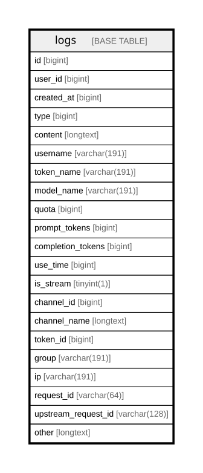

# logs

## Description

<details>
<summary><strong>Table Definition</strong></summary>

```sql
CREATE TABLE `logs` (
  `id` bigint NOT NULL AUTO_INCREMENT,
  `user_id` bigint DEFAULT NULL,
  `created_at` bigint DEFAULT NULL,
  `type` bigint DEFAULT NULL,
  `content` longtext COLLATE utf8mb4_unicode_ci,
  `username` varchar(191) COLLATE utf8mb4_unicode_ci DEFAULT '',
  `token_name` varchar(191) COLLATE utf8mb4_unicode_ci DEFAULT '',
  `model_name` varchar(191) COLLATE utf8mb4_unicode_ci DEFAULT '',
  `quota` bigint DEFAULT '0',
  `prompt_tokens` bigint DEFAULT '0',
  `completion_tokens` bigint DEFAULT '0',
  `use_time` bigint DEFAULT '0',
  `is_stream` tinyint(1) DEFAULT NULL,
  `channel_id` bigint DEFAULT NULL,
  `channel_name` longtext COLLATE utf8mb4_unicode_ci,
  `token_id` bigint DEFAULT '0',
  `group` varchar(191) COLLATE utf8mb4_unicode_ci DEFAULT NULL,
  `ip` varchar(191) COLLATE utf8mb4_unicode_ci DEFAULT '',
  `request_id` varchar(64) COLLATE utf8mb4_unicode_ci DEFAULT '',
  `upstream_request_id` varchar(128) COLLATE utf8mb4_unicode_ci DEFAULT '',
  `other` longtext COLLATE utf8mb4_unicode_ci,
  PRIMARY KEY (`id`),
  KEY `idx_logs_token_name` (`token_name`),
  KEY `idx_logs_ip` (`ip`),
  KEY `idx_logs_request_id` (`request_id`),
  KEY `idx_logs_upstream_request_id` (`upstream_request_id`),
  KEY `idx_created_at_id` (`created_at`,`id`),
  KEY `idx_user_id_id` (`user_id`,`id`),
  KEY `idx_created_at_type` (`created_at`,`type`),
  KEY `index_username_model_name` (`model_name`,`username`),
  KEY `idx_logs_model_name` (`model_name`),
  KEY `idx_logs_channel_id` (`channel_id`),
  KEY `idx_logs_token_id` (`token_id`),
  KEY `idx_logs_group` (`group`),
  KEY `idx_logs_user_id` (`user_id`),
  KEY `idx_logs_username` (`username`)
) ENGINE=InnoDB AUTO_INCREMENT=[Redacted by tbls] DEFAULT CHARSET=utf8mb4 COLLATE=utf8mb4_unicode_ci
```

</details>

## Columns

| Name | Type | Default | Nullable | Extra Definition | Children | Parents | Comment |
| ---- | ---- | ------- | -------- | ---------------- | -------- | ------- | ------- |
| id | bigint |  | false | auto_increment |  |  |  |
| user_id | bigint |  | true |  |  |  |  |
| created_at | bigint |  | true |  |  |  |  |
| type | bigint |  | true |  |  |  |  |
| content | longtext |  | true |  |  |  |  |
| username | varchar(191) |  | true |  |  |  |  |
| token_name | varchar(191) |  | true |  |  |  |  |
| model_name | varchar(191) |  | true |  |  |  |  |
| quota | bigint | 0 | true |  |  |  |  |
| prompt_tokens | bigint | 0 | true |  |  |  |  |
| completion_tokens | bigint | 0 | true |  |  |  |  |
| use_time | bigint | 0 | true |  |  |  |  |
| is_stream | tinyint(1) |  | true |  |  |  |  |
| channel_id | bigint |  | true |  |  |  |  |
| channel_name | longtext |  | true |  |  |  |  |
| token_id | bigint | 0 | true |  |  |  |  |
| group | varchar(191) |  | true |  |  |  |  |
| ip | varchar(191) |  | true |  |  |  |  |
| request_id | varchar(64) |  | true |  |  |  |  |
| upstream_request_id | varchar(128) |  | true |  |  |  |  |
| other | longtext |  | true |  |  |  |  |

## Constraints

| Name | Type | Definition |
| ---- | ---- | ---------- |
| PRIMARY | PRIMARY KEY | PRIMARY KEY (id) |

## Indexes

| Name | Definition |
| ---- | ---------- |
| idx_created_at_id | KEY idx_created_at_id (created_at, id) USING BTREE |
| idx_created_at_type | KEY idx_created_at_type (created_at, type) USING BTREE |
| idx_logs_channel_id | KEY idx_logs_channel_id (channel_id) USING BTREE |
| idx_logs_group | KEY idx_logs_group (group) USING BTREE |
| idx_logs_ip | KEY idx_logs_ip (ip) USING BTREE |
| idx_logs_model_name | KEY idx_logs_model_name (model_name) USING BTREE |
| idx_logs_request_id | KEY idx_logs_request_id (request_id) USING BTREE |
| idx_logs_token_id | KEY idx_logs_token_id (token_id) USING BTREE |
| idx_logs_token_name | KEY idx_logs_token_name (token_name) USING BTREE |
| idx_logs_upstream_request_id | KEY idx_logs_upstream_request_id (upstream_request_id) USING BTREE |
| idx_logs_user_id | KEY idx_logs_user_id (user_id) USING BTREE |
| idx_logs_username | KEY idx_logs_username (username) USING BTREE |
| idx_user_id_id | KEY idx_user_id_id (user_id, id) USING BTREE |
| index_username_model_name | KEY index_username_model_name (model_name, username) USING BTREE |
| PRIMARY | PRIMARY KEY (id) USING BTREE |

## Relations



---

> Generated by [tbls](https://github.com/k1LoW/tbls)
