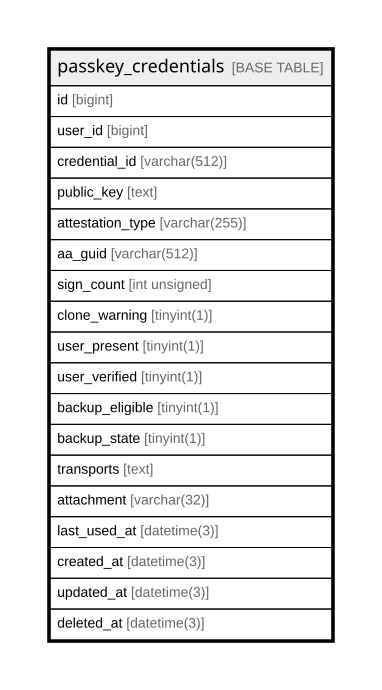

# passkey_credentials

## Description

<details>
<summary><strong>Table Definition</strong></summary>

```sql
CREATE TABLE `passkey_credentials` (
  `id` bigint NOT NULL AUTO_INCREMENT,
  `user_id` bigint NOT NULL,
  `credential_id` varchar(512) COLLATE utf8mb4_unicode_ci NOT NULL,
  `public_key` text COLLATE utf8mb4_unicode_ci NOT NULL,
  `attestation_type` varchar(255) COLLATE utf8mb4_unicode_ci DEFAULT NULL,
  `aa_guid` varchar(512) COLLATE utf8mb4_unicode_ci DEFAULT NULL,
  `sign_count` int unsigned DEFAULT '0',
  `clone_warning` tinyint(1) DEFAULT NULL,
  `user_present` tinyint(1) DEFAULT NULL,
  `user_verified` tinyint(1) DEFAULT NULL,
  `backup_eligible` tinyint(1) DEFAULT NULL,
  `backup_state` tinyint(1) DEFAULT NULL,
  `transports` text COLLATE utf8mb4_unicode_ci,
  `attachment` varchar(32) COLLATE utf8mb4_unicode_ci DEFAULT NULL,
  `last_used_at` datetime(3) DEFAULT NULL,
  `created_at` datetime(3) DEFAULT NULL,
  `updated_at` datetime(3) DEFAULT NULL,
  `deleted_at` datetime(3) DEFAULT NULL,
  PRIMARY KEY (`id`),
  UNIQUE KEY `idx_passkey_credentials_user_id` (`user_id`),
  UNIQUE KEY `idx_passkey_credentials_credential_id` (`credential_id`),
  KEY `idx_passkey_credentials_deleted_at` (`deleted_at`)
) ENGINE=InnoDB DEFAULT CHARSET=utf8mb4 COLLATE=utf8mb4_unicode_ci
```

</details>

## Columns

| Name | Type | Default | Nullable | Extra Definition | Children | Parents | Comment |
| ---- | ---- | ------- | -------- | ---------------- | -------- | ------- | ------- |
| id | bigint |  | false | auto_increment |  |  |  |
| user_id | bigint |  | false |  |  |  |  |
| credential_id | varchar(512) |  | false |  |  |  |  |
| public_key | text |  | false |  |  |  |  |
| attestation_type | varchar(255) |  | true |  |  |  |  |
| aa_guid | varchar(512) |  | true |  |  |  |  |
| sign_count | int unsigned | 0 | true |  |  |  |  |
| clone_warning | tinyint(1) |  | true |  |  |  |  |
| user_present | tinyint(1) |  | true |  |  |  |  |
| user_verified | tinyint(1) |  | true |  |  |  |  |
| backup_eligible | tinyint(1) |  | true |  |  |  |  |
| backup_state | tinyint(1) |  | true |  |  |  |  |
| transports | text |  | true |  |  |  |  |
| attachment | varchar(32) |  | true |  |  |  |  |
| last_used_at | datetime(3) |  | true |  |  |  |  |
| created_at | datetime(3) |  | true |  |  |  |  |
| updated_at | datetime(3) |  | true |  |  |  |  |
| deleted_at | datetime(3) |  | true |  |  |  |  |

## Constraints

| Name | Type | Definition |
| ---- | ---- | ---------- |
| idx_passkey_credentials_credential_id | UNIQUE | UNIQUE KEY idx_passkey_credentials_credential_id (credential_id) |
| idx_passkey_credentials_user_id | UNIQUE | UNIQUE KEY idx_passkey_credentials_user_id (user_id) |
| PRIMARY | PRIMARY KEY | PRIMARY KEY (id) |

## Indexes

| Name | Definition |
| ---- | ---------- |
| idx_passkey_credentials_deleted_at | KEY idx_passkey_credentials_deleted_at (deleted_at) USING BTREE |
| PRIMARY | PRIMARY KEY (id) USING BTREE |
| idx_passkey_credentials_credential_id | UNIQUE KEY idx_passkey_credentials_credential_id (credential_id) USING BTREE |
| idx_passkey_credentials_user_id | UNIQUE KEY idx_passkey_credentials_user_id (user_id) USING BTREE |

## Relations



---

> Generated by [tbls](https://github.com/k1LoW/tbls)
