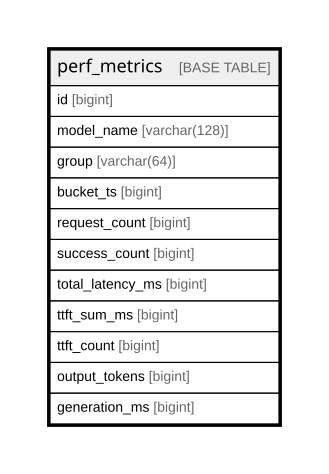

# perf_metrics

## Description

<details>
<summary><strong>Table Definition</strong></summary>

```sql
CREATE TABLE `perf_metrics` (
  `id` bigint NOT NULL AUTO_INCREMENT,
  `model_name` varchar(128) COLLATE utf8mb4_unicode_ci DEFAULT NULL,
  `group` varchar(64) COLLATE utf8mb4_unicode_ci DEFAULT NULL,
  `bucket_ts` bigint DEFAULT NULL,
  `request_count` bigint DEFAULT '0',
  `success_count` bigint DEFAULT '0',
  `total_latency_ms` bigint DEFAULT '0',
  `ttft_sum_ms` bigint DEFAULT '0',
  `ttft_count` bigint DEFAULT '0',
  `output_tokens` bigint DEFAULT '0',
  `generation_ms` bigint DEFAULT '0',
  PRIMARY KEY (`id`),
  UNIQUE KEY `idx_perf_model_group_bucket` (`model_name`,`group`,`bucket_ts`),
  KEY `idx_perf_bucket_ts` (`bucket_ts`)
) ENGINE=InnoDB AUTO_INCREMENT=[Redacted by tbls] DEFAULT CHARSET=utf8mb4 COLLATE=utf8mb4_unicode_ci
```

</details>

## Columns

| Name | Type | Default | Nullable | Extra Definition | Children | Parents | Comment |
| ---- | ---- | ------- | -------- | ---------------- | -------- | ------- | ------- |
| id | bigint |  | false | auto_increment |  |  |  |
| model_name | varchar(128) |  | true |  |  |  |  |
| group | varchar(64) |  | true |  |  |  |  |
| bucket_ts | bigint |  | true |  |  |  |  |
| request_count | bigint | 0 | true |  |  |  |  |
| success_count | bigint | 0 | true |  |  |  |  |
| total_latency_ms | bigint | 0 | true |  |  |  |  |
| ttft_sum_ms | bigint | 0 | true |  |  |  |  |
| ttft_count | bigint | 0 | true |  |  |  |  |
| output_tokens | bigint | 0 | true |  |  |  |  |
| generation_ms | bigint | 0 | true |  |  |  |  |

## Constraints

| Name | Type | Definition |
| ---- | ---- | ---------- |
| idx_perf_model_group_bucket | UNIQUE | UNIQUE KEY idx_perf_model_group_bucket (model_name, group, bucket_ts) |
| PRIMARY | PRIMARY KEY | PRIMARY KEY (id) |

## Indexes

| Name | Definition |
| ---- | ---------- |
| idx_perf_bucket_ts | KEY idx_perf_bucket_ts (bucket_ts) USING BTREE |
| PRIMARY | PRIMARY KEY (id) USING BTREE |
| idx_perf_model_group_bucket | UNIQUE KEY idx_perf_model_group_bucket (model_name, group, bucket_ts) USING BTREE |

## Relations



---

> Generated by [tbls](https://github.com/k1LoW/tbls)
