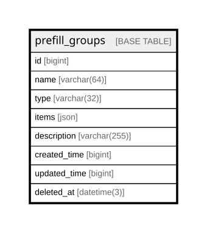

# prefill_groups

## Description

<details>
<summary><strong>Table Definition</strong></summary>

```sql
CREATE TABLE `prefill_groups` (
  `id` bigint NOT NULL AUTO_INCREMENT,
  `name` varchar(64) COLLATE utf8mb4_unicode_ci NOT NULL,
  `type` varchar(32) COLLATE utf8mb4_unicode_ci NOT NULL,
  `items` json DEFAULT NULL,
  `description` varchar(255) COLLATE utf8mb4_unicode_ci DEFAULT NULL,
  `created_time` bigint DEFAULT NULL,
  `updated_time` bigint DEFAULT NULL,
  `deleted_at` datetime(3) DEFAULT NULL,
  PRIMARY KEY (`id`),
  UNIQUE KEY `uk_prefill_name` (`name`),
  KEY `idx_prefill_groups_type` (`type`),
  KEY `idx_prefill_groups_deleted_at` (`deleted_at`)
) ENGINE=InnoDB DEFAULT CHARSET=utf8mb4 COLLATE=utf8mb4_unicode_ci
```

</details>

## Columns

| Name | Type | Default | Nullable | Extra Definition | Children | Parents | Comment |
| ---- | ---- | ------- | -------- | ---------------- | -------- | ------- | ------- |
| id | bigint |  | false | auto_increment |  |  |  |
| name | varchar(64) |  | false |  |  |  |  |
| type | varchar(32) |  | false |  |  |  |  |
| items | json |  | true |  |  |  |  |
| description | varchar(255) |  | true |  |  |  |  |
| created_time | bigint |  | true |  |  |  |  |
| updated_time | bigint |  | true |  |  |  |  |
| deleted_at | datetime(3) |  | true |  |  |  |  |

## Constraints

| Name | Type | Definition |
| ---- | ---- | ---------- |
| PRIMARY | PRIMARY KEY | PRIMARY KEY (id) |
| uk_prefill_name | UNIQUE | UNIQUE KEY uk_prefill_name (name) |

## Indexes

| Name | Definition |
| ---- | ---------- |
| idx_prefill_groups_deleted_at | KEY idx_prefill_groups_deleted_at (deleted_at) USING BTREE |
| idx_prefill_groups_type | KEY idx_prefill_groups_type (type) USING BTREE |
| PRIMARY | PRIMARY KEY (id) USING BTREE |
| uk_prefill_name | UNIQUE KEY uk_prefill_name (name) USING BTREE |

## Relations



---

> Generated by [tbls](https://github.com/k1LoW/tbls)
