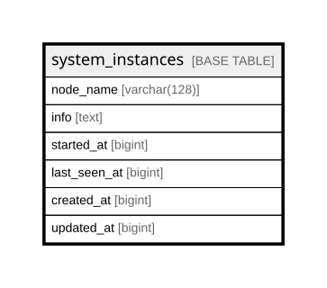

# system_instances

## Description

<details>
<summary><strong>Table Definition</strong></summary>

```sql
CREATE TABLE `system_instances` (
  `node_name` varchar(128) COLLATE utf8mb4_unicode_ci NOT NULL,
  `info` text COLLATE utf8mb4_unicode_ci,
  `started_at` bigint DEFAULT NULL,
  `last_seen_at` bigint DEFAULT NULL,
  `created_at` bigint DEFAULT NULL,
  `updated_at` bigint DEFAULT NULL,
  PRIMARY KEY (`node_name`),
  KEY `idx_system_instances_started_at` (`started_at`),
  KEY `idx_system_instances_last_seen_at` (`last_seen_at`),
  KEY `idx_system_instances_created_at` (`created_at`),
  KEY `idx_system_instances_updated_at` (`updated_at`)
) ENGINE=InnoDB DEFAULT CHARSET=utf8mb4 COLLATE=utf8mb4_unicode_ci
```

</details>

## Columns

| Name | Type | Default | Nullable | Children | Parents | Comment |
| ---- | ---- | ------- | -------- | -------- | ------- | ------- |
| node_name | varchar(128) |  | false |  |  |  |
| info | text |  | true |  |  |  |
| started_at | bigint |  | true |  |  |  |
| last_seen_at | bigint |  | true |  |  |  |
| created_at | bigint |  | true |  |  |  |
| updated_at | bigint |  | true |  |  |  |

## Constraints

| Name | Type | Definition |
| ---- | ---- | ---------- |
| PRIMARY | PRIMARY KEY | PRIMARY KEY (node_name) |

## Indexes

| Name | Definition |
| ---- | ---------- |
| idx_system_instances_created_at | KEY idx_system_instances_created_at (created_at) USING BTREE |
| idx_system_instances_last_seen_at | KEY idx_system_instances_last_seen_at (last_seen_at) USING BTREE |
| idx_system_instances_started_at | KEY idx_system_instances_started_at (started_at) USING BTREE |
| idx_system_instances_updated_at | KEY idx_system_instances_updated_at (updated_at) USING BTREE |
| PRIMARY | PRIMARY KEY (node_name) USING BTREE |

## Relations



---

> Generated by [tbls](https://github.com/k1LoW/tbls)
