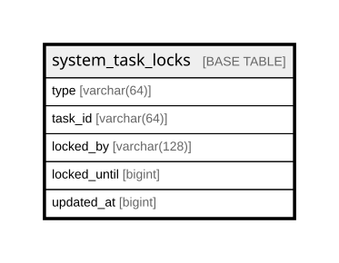

# system_task_locks

## Description

<details>
<summary><strong>Table Definition</strong></summary>

```sql
CREATE TABLE `system_task_locks` (
  `type` varchar(64) COLLATE utf8mb4_unicode_ci NOT NULL,
  `task_id` varchar(64) COLLATE utf8mb4_unicode_ci DEFAULT NULL,
  `locked_by` varchar(128) COLLATE utf8mb4_unicode_ci DEFAULT NULL,
  `locked_until` bigint DEFAULT NULL,
  `updated_at` bigint DEFAULT NULL,
  PRIMARY KEY (`type`),
  KEY `idx_system_task_locks_task_id` (`task_id`),
  KEY `idx_system_task_locks_locked_by` (`locked_by`),
  KEY `idx_system_task_locks_locked_until` (`locked_until`),
  KEY `idx_system_task_locks_updated_at` (`updated_at`)
) ENGINE=InnoDB DEFAULT CHARSET=utf8mb4 COLLATE=utf8mb4_unicode_ci
```

</details>

## Columns

| Name | Type | Default | Nullable | Children | Parents | Comment |
| ---- | ---- | ------- | -------- | -------- | ------- | ------- |
| type | varchar(64) |  | false |  |  |  |
| task_id | varchar(64) |  | true |  |  |  |
| locked_by | varchar(128) |  | true |  |  |  |
| locked_until | bigint |  | true |  |  |  |
| updated_at | bigint |  | true |  |  |  |

## Constraints

| Name | Type | Definition |
| ---- | ---- | ---------- |
| PRIMARY | PRIMARY KEY | PRIMARY KEY (type) |

## Indexes

| Name | Definition |
| ---- | ---------- |
| idx_system_task_locks_locked_by | KEY idx_system_task_locks_locked_by (locked_by) USING BTREE |
| idx_system_task_locks_locked_until | KEY idx_system_task_locks_locked_until (locked_until) USING BTREE |
| idx_system_task_locks_task_id | KEY idx_system_task_locks_task_id (task_id) USING BTREE |
| idx_system_task_locks_updated_at | KEY idx_system_task_locks_updated_at (updated_at) USING BTREE |
| PRIMARY | PRIMARY KEY (type) USING BTREE |

## Relations



---

> Generated by [tbls](https://github.com/k1LoW/tbls)
