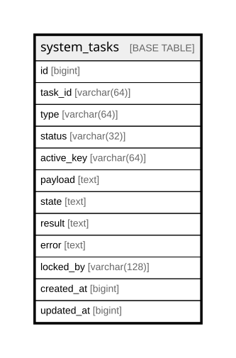

# system_tasks

## Description

<details>
<summary><strong>Table Definition</strong></summary>

```sql
CREATE TABLE `system_tasks` (
  `id` bigint NOT NULL AUTO_INCREMENT,
  `task_id` varchar(64) COLLATE utf8mb4_unicode_ci DEFAULT NULL,
  `type` varchar(64) COLLATE utf8mb4_unicode_ci DEFAULT NULL,
  `status` varchar(32) COLLATE utf8mb4_unicode_ci DEFAULT NULL,
  `active_key` varchar(64) COLLATE utf8mb4_unicode_ci DEFAULT NULL,
  `payload` text COLLATE utf8mb4_unicode_ci,
  `state` text COLLATE utf8mb4_unicode_ci,
  `result` text COLLATE utf8mb4_unicode_ci,
  `error` text COLLATE utf8mb4_unicode_ci,
  `locked_by` varchar(128) COLLATE utf8mb4_unicode_ci DEFAULT NULL,
  `created_at` bigint DEFAULT NULL,
  `updated_at` bigint DEFAULT NULL,
  PRIMARY KEY (`id`),
  UNIQUE KEY `idx_system_tasks_task_id` (`task_id`),
  UNIQUE KEY `idx_system_tasks_active_key` (`active_key`),
  KEY `idx_system_tasks_updated_at` (`updated_at`),
  KEY `idx_system_tasks_type` (`type`),
  KEY `idx_system_tasks_status` (`status`),
  KEY `idx_system_tasks_locked_by` (`locked_by`),
  KEY `idx_system_tasks_created_at` (`created_at`)
) ENGINE=InnoDB AUTO_INCREMENT=[Redacted by tbls] DEFAULT CHARSET=utf8mb4 COLLATE=utf8mb4_unicode_ci
```

</details>

## Columns

| Name | Type | Default | Nullable | Extra Definition | Children | Parents | Comment |
| ---- | ---- | ------- | -------- | ---------------- | -------- | ------- | ------- |
| id | bigint |  | false | auto_increment |  |  |  |
| task_id | varchar(64) |  | true |  |  |  |  |
| type | varchar(64) |  | true |  |  |  |  |
| status | varchar(32) |  | true |  |  |  |  |
| active_key | varchar(64) |  | true |  |  |  |  |
| payload | text |  | true |  |  |  |  |
| state | text |  | true |  |  |  |  |
| result | text |  | true |  |  |  |  |
| error | text |  | true |  |  |  |  |
| locked_by | varchar(128) |  | true |  |  |  |  |
| created_at | bigint |  | true |  |  |  |  |
| updated_at | bigint |  | true |  |  |  |  |

## Constraints

| Name | Type | Definition |
| ---- | ---- | ---------- |
| idx_system_tasks_active_key | UNIQUE | UNIQUE KEY idx_system_tasks_active_key (active_key) |
| idx_system_tasks_task_id | UNIQUE | UNIQUE KEY idx_system_tasks_task_id (task_id) |
| PRIMARY | PRIMARY KEY | PRIMARY KEY (id) |

## Indexes

| Name | Definition |
| ---- | ---------- |
| idx_system_tasks_created_at | KEY idx_system_tasks_created_at (created_at) USING BTREE |
| idx_system_tasks_locked_by | KEY idx_system_tasks_locked_by (locked_by) USING BTREE |
| idx_system_tasks_status | KEY idx_system_tasks_status (status) USING BTREE |
| idx_system_tasks_type | KEY idx_system_tasks_type (type) USING BTREE |
| idx_system_tasks_updated_at | KEY idx_system_tasks_updated_at (updated_at) USING BTREE |
| PRIMARY | PRIMARY KEY (id) USING BTREE |
| idx_system_tasks_active_key | UNIQUE KEY idx_system_tasks_active_key (active_key) USING BTREE |
| idx_system_tasks_task_id | UNIQUE KEY idx_system_tasks_task_id (task_id) USING BTREE |

## Relations



---

> Generated by [tbls](https://github.com/k1LoW/tbls)
