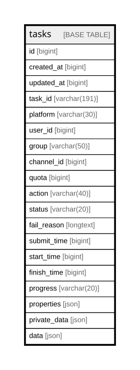

# tasks

## Description

<details>
<summary><strong>Table Definition</strong></summary>

```sql
CREATE TABLE `tasks` (
  `id` bigint NOT NULL AUTO_INCREMENT,
  `created_at` bigint DEFAULT NULL,
  `updated_at` bigint DEFAULT NULL,
  `task_id` varchar(191) COLLATE utf8mb4_unicode_ci DEFAULT NULL,
  `platform` varchar(30) COLLATE utf8mb4_unicode_ci DEFAULT NULL,
  `user_id` bigint DEFAULT NULL,
  `group` varchar(50) COLLATE utf8mb4_unicode_ci DEFAULT NULL,
  `channel_id` bigint DEFAULT NULL,
  `quota` bigint DEFAULT NULL,
  `action` varchar(40) COLLATE utf8mb4_unicode_ci DEFAULT NULL,
  `status` varchar(20) COLLATE utf8mb4_unicode_ci DEFAULT NULL,
  `fail_reason` longtext COLLATE utf8mb4_unicode_ci,
  `submit_time` bigint DEFAULT NULL,
  `start_time` bigint DEFAULT NULL,
  `finish_time` bigint DEFAULT NULL,
  `progress` varchar(20) COLLATE utf8mb4_unicode_ci DEFAULT NULL,
  `properties` json DEFAULT NULL,
  `private_data` json DEFAULT NULL,
  `data` json DEFAULT NULL,
  PRIMARY KEY (`id`),
  KEY `idx_tasks_created_at` (`created_at`),
  KEY `idx_tasks_task_id` (`task_id`),
  KEY `idx_tasks_platform` (`platform`),
  KEY `idx_tasks_action` (`action`),
  KEY `idx_tasks_status` (`status`),
  KEY `idx_tasks_submit_time` (`submit_time`),
  KEY `idx_tasks_start_time` (`start_time`),
  KEY `idx_tasks_finish_time` (`finish_time`),
  KEY `idx_tasks_user_id` (`user_id`),
  KEY `idx_tasks_channel_id` (`channel_id`),
  KEY `idx_tasks_progress` (`progress`)
) ENGINE=InnoDB AUTO_INCREMENT=[Redacted by tbls] DEFAULT CHARSET=utf8mb4 COLLATE=utf8mb4_unicode_ci
```

</details>

## Columns

| Name | Type | Default | Nullable | Extra Definition | Children | Parents | Comment |
| ---- | ---- | ------- | -------- | ---------------- | -------- | ------- | ------- |
| id | bigint |  | false | auto_increment |  |  |  |
| created_at | bigint |  | true |  |  |  |  |
| updated_at | bigint |  | true |  |  |  |  |
| task_id | varchar(191) |  | true |  |  |  |  |
| platform | varchar(30) |  | true |  |  |  |  |
| user_id | bigint |  | true |  |  |  |  |
| group | varchar(50) |  | true |  |  |  |  |
| channel_id | bigint |  | true |  |  |  |  |
| quota | bigint |  | true |  |  |  |  |
| action | varchar(40) |  | true |  |  |  |  |
| status | varchar(20) |  | true |  |  |  |  |
| fail_reason | longtext |  | true |  |  |  |  |
| submit_time | bigint |  | true |  |  |  |  |
| start_time | bigint |  | true |  |  |  |  |
| finish_time | bigint |  | true |  |  |  |  |
| progress | varchar(20) |  | true |  |  |  |  |
| properties | json |  | true |  |  |  |  |
| private_data | json |  | true |  |  |  |  |
| data | json |  | true |  |  |  |  |

## Constraints

| Name | Type | Definition |
| ---- | ---- | ---------- |
| PRIMARY | PRIMARY KEY | PRIMARY KEY (id) |

## Indexes

| Name | Definition |
| ---- | ---------- |
| idx_tasks_action | KEY idx_tasks_action (action) USING BTREE |
| idx_tasks_channel_id | KEY idx_tasks_channel_id (channel_id) USING BTREE |
| idx_tasks_created_at | KEY idx_tasks_created_at (created_at) USING BTREE |
| idx_tasks_finish_time | KEY idx_tasks_finish_time (finish_time) USING BTREE |
| idx_tasks_platform | KEY idx_tasks_platform (platform) USING BTREE |
| idx_tasks_progress | KEY idx_tasks_progress (progress) USING BTREE |
| idx_tasks_start_time | KEY idx_tasks_start_time (start_time) USING BTREE |
| idx_tasks_status | KEY idx_tasks_status (status) USING BTREE |
| idx_tasks_submit_time | KEY idx_tasks_submit_time (submit_time) USING BTREE |
| idx_tasks_task_id | KEY idx_tasks_task_id (task_id) USING BTREE |
| idx_tasks_user_id | KEY idx_tasks_user_id (user_id) USING BTREE |
| PRIMARY | PRIMARY KEY (id) USING BTREE |

## Relations



---

> Generated by [tbls](https://github.com/k1LoW/tbls)
