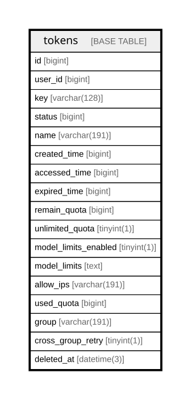

# tokens

## Description

<details>
<summary><strong>Table Definition</strong></summary>

```sql
CREATE TABLE `tokens` (
  `id` bigint NOT NULL AUTO_INCREMENT,
  `user_id` bigint DEFAULT NULL,
  `key` varchar(128) COLLATE utf8mb4_unicode_ci DEFAULT NULL,
  `status` bigint DEFAULT '1',
  `name` varchar(191) COLLATE utf8mb4_unicode_ci DEFAULT NULL,
  `created_time` bigint DEFAULT NULL,
  `accessed_time` bigint DEFAULT NULL,
  `expired_time` bigint DEFAULT '-1',
  `remain_quota` bigint DEFAULT '0',
  `unlimited_quota` tinyint(1) DEFAULT NULL,
  `model_limits_enabled` tinyint(1) DEFAULT NULL,
  `model_limits` text COLLATE utf8mb4_unicode_ci,
  `allow_ips` varchar(191) COLLATE utf8mb4_unicode_ci DEFAULT '',
  `used_quota` bigint DEFAULT '0',
  `group` varchar(191) COLLATE utf8mb4_unicode_ci DEFAULT '',
  `cross_group_retry` tinyint(1) DEFAULT NULL,
  `deleted_at` datetime(3) DEFAULT NULL,
  PRIMARY KEY (`id`),
  UNIQUE KEY `idx_tokens_key` (`key`),
  KEY `idx_tokens_user_id` (`user_id`),
  KEY `idx_tokens_name` (`name`),
  KEY `idx_tokens_deleted_at` (`deleted_at`)
) ENGINE=InnoDB AUTO_INCREMENT=[Redacted by tbls] DEFAULT CHARSET=utf8mb4 COLLATE=utf8mb4_unicode_ci
```

</details>

## Columns

| Name | Type | Default | Nullable | Extra Definition | Children | Parents | Comment |
| ---- | ---- | ------- | -------- | ---------------- | -------- | ------- | ------- |
| id | bigint |  | false | auto_increment |  |  |  |
| user_id | bigint |  | true |  |  |  |  |
| key | varchar(128) |  | true |  |  |  |  |
| status | bigint | 1 | true |  |  |  |  |
| name | varchar(191) |  | true |  |  |  |  |
| created_time | bigint |  | true |  |  |  |  |
| accessed_time | bigint |  | true |  |  |  |  |
| expired_time | bigint | -1 | true |  |  |  |  |
| remain_quota | bigint | 0 | true |  |  |  |  |
| unlimited_quota | tinyint(1) |  | true |  |  |  |  |
| model_limits_enabled | tinyint(1) |  | true |  |  |  |  |
| model_limits | text |  | true |  |  |  |  |
| allow_ips | varchar(191) |  | true |  |  |  |  |
| used_quota | bigint | 0 | true |  |  |  |  |
| group | varchar(191) |  | true |  |  |  |  |
| cross_group_retry | tinyint(1) |  | true |  |  |  |  |
| deleted_at | datetime(3) |  | true |  |  |  |  |

## Constraints

| Name | Type | Definition |
| ---- | ---- | ---------- |
| idx_tokens_key | UNIQUE | UNIQUE KEY idx_tokens_key (key) |
| PRIMARY | PRIMARY KEY | PRIMARY KEY (id) |

## Indexes

| Name | Definition |
| ---- | ---------- |
| idx_tokens_deleted_at | KEY idx_tokens_deleted_at (deleted_at) USING BTREE |
| idx_tokens_name | KEY idx_tokens_name (name) USING BTREE |
| idx_tokens_user_id | KEY idx_tokens_user_id (user_id) USING BTREE |
| PRIMARY | PRIMARY KEY (id) USING BTREE |
| idx_tokens_key | UNIQUE KEY idx_tokens_key (key) USING BTREE |

## Relations



---

> Generated by [tbls](https://github.com/k1LoW/tbls)
