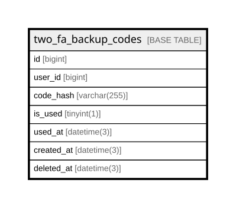

# two_fa_backup_codes

## Description

<details>
<summary><strong>Table Definition</strong></summary>

```sql
CREATE TABLE `two_fa_backup_codes` (
  `id` bigint NOT NULL AUTO_INCREMENT,
  `user_id` bigint NOT NULL,
  `code_hash` varchar(255) COLLATE utf8mb4_unicode_ci NOT NULL,
  `is_used` tinyint(1) DEFAULT NULL,
  `used_at` datetime(3) DEFAULT NULL,
  `created_at` datetime(3) DEFAULT NULL,
  `deleted_at` datetime(3) DEFAULT NULL,
  PRIMARY KEY (`id`),
  KEY `idx_two_fa_backup_codes_user_id` (`user_id`),
  KEY `idx_two_fa_backup_codes_deleted_at` (`deleted_at`)
) ENGINE=InnoDB AUTO_INCREMENT=[Redacted by tbls] DEFAULT CHARSET=utf8mb4 COLLATE=utf8mb4_unicode_ci
```

</details>

## Columns

| Name | Type | Default | Nullable | Extra Definition | Children | Parents | Comment |
| ---- | ---- | ------- | -------- | ---------------- | -------- | ------- | ------- |
| id | bigint |  | false | auto_increment |  |  |  |
| user_id | bigint |  | false |  |  |  |  |
| code_hash | varchar(255) |  | false |  |  |  |  |
| is_used | tinyint(1) |  | true |  |  |  |  |
| used_at | datetime(3) |  | true |  |  |  |  |
| created_at | datetime(3) |  | true |  |  |  |  |
| deleted_at | datetime(3) |  | true |  |  |  |  |

## Constraints

| Name | Type | Definition |
| ---- | ---- | ---------- |
| PRIMARY | PRIMARY KEY | PRIMARY KEY (id) |

## Indexes

| Name | Definition |
| ---- | ---------- |
| idx_two_fa_backup_codes_deleted_at | KEY idx_two_fa_backup_codes_deleted_at (deleted_at) USING BTREE |
| idx_two_fa_backup_codes_user_id | KEY idx_two_fa_backup_codes_user_id (user_id) USING BTREE |
| PRIMARY | PRIMARY KEY (id) USING BTREE |

## Relations



---

> Generated by [tbls](https://github.com/k1LoW/tbls)
