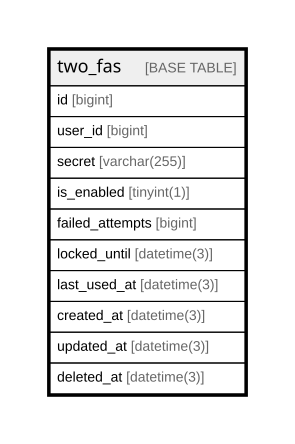

# two_fas

## Description

<details>
<summary><strong>Table Definition</strong></summary>

```sql
CREATE TABLE `two_fas` (
  `id` bigint NOT NULL AUTO_INCREMENT,
  `user_id` bigint NOT NULL,
  `secret` varchar(255) COLLATE utf8mb4_unicode_ci NOT NULL,
  `is_enabled` tinyint(1) DEFAULT NULL,
  `failed_attempts` bigint DEFAULT '0',
  `locked_until` datetime(3) DEFAULT NULL,
  `last_used_at` datetime(3) DEFAULT NULL,
  `created_at` datetime(3) DEFAULT NULL,
  `updated_at` datetime(3) DEFAULT NULL,
  `deleted_at` datetime(3) DEFAULT NULL,
  PRIMARY KEY (`id`),
  UNIQUE KEY `user_id` (`user_id`),
  KEY `idx_two_fas_user_id` (`user_id`),
  KEY `idx_two_fas_deleted_at` (`deleted_at`)
) ENGINE=InnoDB AUTO_INCREMENT=[Redacted by tbls] DEFAULT CHARSET=utf8mb4 COLLATE=utf8mb4_unicode_ci
```

</details>

## Columns

| Name | Type | Default | Nullable | Extra Definition | Children | Parents | Comment |
| ---- | ---- | ------- | -------- | ---------------- | -------- | ------- | ------- |
| id | bigint |  | false | auto_increment |  |  |  |
| user_id | bigint |  | false |  |  |  |  |
| secret | varchar(255) |  | false |  |  |  |  |
| is_enabled | tinyint(1) |  | true |  |  |  |  |
| failed_attempts | bigint | 0 | true |  |  |  |  |
| locked_until | datetime(3) |  | true |  |  |  |  |
| last_used_at | datetime(3) |  | true |  |  |  |  |
| created_at | datetime(3) |  | true |  |  |  |  |
| updated_at | datetime(3) |  | true |  |  |  |  |
| deleted_at | datetime(3) |  | true |  |  |  |  |

## Constraints

| Name | Type | Definition |
| ---- | ---- | ---------- |
| PRIMARY | PRIMARY KEY | PRIMARY KEY (id) |
| user_id | UNIQUE | UNIQUE KEY user_id (user_id) |

## Indexes

| Name | Definition |
| ---- | ---------- |
| idx_two_fas_deleted_at | KEY idx_two_fas_deleted_at (deleted_at) USING BTREE |
| idx_two_fas_user_id | KEY idx_two_fas_user_id (user_id) USING BTREE |
| PRIMARY | PRIMARY KEY (id) USING BTREE |
| user_id | UNIQUE KEY user_id (user_id) USING BTREE |

## Relations



---

> Generated by [tbls](https://github.com/k1LoW/tbls)
