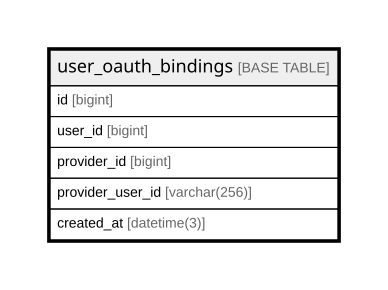

# user_oauth_bindings

## Description

<details>
<summary><strong>Table Definition</strong></summary>

```sql
CREATE TABLE `user_oauth_bindings` (
  `id` bigint NOT NULL AUTO_INCREMENT,
  `user_id` bigint NOT NULL,
  `provider_id` bigint NOT NULL,
  `provider_user_id` varchar(256) COLLATE utf8mb4_unicode_ci NOT NULL,
  `created_at` datetime(3) DEFAULT NULL,
  PRIMARY KEY (`id`),
  UNIQUE KEY `ux_user_provider` (`user_id`,`provider_id`),
  UNIQUE KEY `ux_provider_userid` (`provider_id`,`provider_user_id`)
) ENGINE=InnoDB DEFAULT CHARSET=utf8mb4 COLLATE=utf8mb4_unicode_ci
```

</details>

## Columns

| Name | Type | Default | Nullable | Extra Definition | Children | Parents | Comment |
| ---- | ---- | ------- | -------- | ---------------- | -------- | ------- | ------- |
| id | bigint |  | false | auto_increment |  |  |  |
| user_id | bigint |  | false |  |  |  |  |
| provider_id | bigint |  | false |  |  |  |  |
| provider_user_id | varchar(256) |  | false |  |  |  |  |
| created_at | datetime(3) |  | true |  |  |  |  |

## Constraints

| Name | Type | Definition |
| ---- | ---- | ---------- |
| PRIMARY | PRIMARY KEY | PRIMARY KEY (id) |
| ux_provider_userid | UNIQUE | UNIQUE KEY ux_provider_userid (provider_id, provider_user_id) |
| ux_user_provider | UNIQUE | UNIQUE KEY ux_user_provider (user_id, provider_id) |

## Indexes

| Name | Definition |
| ---- | ---------- |
| PRIMARY | PRIMARY KEY (id) USING BTREE |
| ux_provider_userid | UNIQUE KEY ux_provider_userid (provider_id, provider_user_id) USING BTREE |
| ux_user_provider | UNIQUE KEY ux_user_provider (user_id, provider_id) USING BTREE |

## Relations



---

> Generated by [tbls](https://github.com/k1LoW/tbls)
