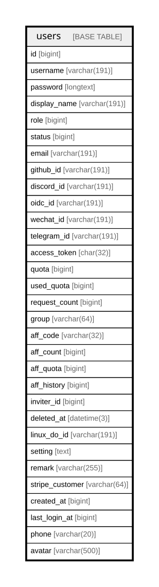

# users

## Description

<details>
<summary><strong>Table Definition</strong></summary>

```sql
CREATE TABLE `users` (
  `id` bigint NOT NULL AUTO_INCREMENT,
  `username` varchar(191) COLLATE utf8mb4_unicode_ci DEFAULT NULL,
  `password` longtext COLLATE utf8mb4_unicode_ci NOT NULL,
  `display_name` varchar(191) COLLATE utf8mb4_unicode_ci DEFAULT NULL,
  `role` bigint DEFAULT '1',
  `status` bigint DEFAULT '1',
  `email` varchar(191) COLLATE utf8mb4_unicode_ci DEFAULT NULL,
  `github_id` varchar(191) COLLATE utf8mb4_unicode_ci DEFAULT NULL,
  `discord_id` varchar(191) COLLATE utf8mb4_unicode_ci DEFAULT NULL,
  `oidc_id` varchar(191) COLLATE utf8mb4_unicode_ci DEFAULT NULL,
  `wechat_id` varchar(191) COLLATE utf8mb4_unicode_ci DEFAULT NULL,
  `telegram_id` varchar(191) COLLATE utf8mb4_unicode_ci DEFAULT NULL,
  `access_token` char(32) COLLATE utf8mb4_unicode_ci DEFAULT NULL,
  `quota` bigint DEFAULT '0',
  `used_quota` bigint DEFAULT '0',
  `request_count` bigint DEFAULT '0',
  `group` varchar(64) COLLATE utf8mb4_unicode_ci DEFAULT 'default',
  `aff_code` varchar(32) COLLATE utf8mb4_unicode_ci DEFAULT NULL,
  `aff_count` bigint DEFAULT '0',
  `aff_quota` bigint DEFAULT '0',
  `aff_history` bigint DEFAULT '0',
  `inviter_id` bigint DEFAULT NULL,
  `deleted_at` datetime(3) DEFAULT NULL,
  `linux_do_id` varchar(191) COLLATE utf8mb4_unicode_ci DEFAULT NULL,
  `setting` text COLLATE utf8mb4_unicode_ci,
  `remark` varchar(255) COLLATE utf8mb4_unicode_ci DEFAULT NULL,
  `stripe_customer` varchar(64) COLLATE utf8mb4_unicode_ci DEFAULT NULL,
  `created_at` bigint DEFAULT NULL,
  `last_login_at` bigint DEFAULT '0',
  `phone` varchar(20) COLLATE utf8mb4_unicode_ci DEFAULT NULL COMMENT '手机号',
  `avatar` varchar(500) COLLATE utf8mb4_unicode_ci DEFAULT NULL COMMENT '头像 URL',
  PRIMARY KEY (`id`),
  UNIQUE KEY `username` (`username`),
  UNIQUE KEY `idx_users_access_token` (`access_token`),
  UNIQUE KEY `idx_users_aff_code` (`aff_code`),
  KEY `idx_users_stripe_customer` (`stripe_customer`),
  KEY `idx_users_username` (`username`),
  KEY `idx_users_git_hub_id` (`github_id`),
  KEY `idx_users_discord_id` (`discord_id`),
  KEY `idx_users_oidc_id` (`oidc_id`),
  KEY `idx_users_telegram_id` (`telegram_id`),
  KEY `idx_users_inviter_id` (`inviter_id`),
  KEY `idx_users_display_name` (`display_name`),
  KEY `idx_users_email` (`email`),
  KEY `idx_users_we_chat_id` (`wechat_id`),
  KEY `idx_users_deleted_at` (`deleted_at`),
  KEY `idx_users_linux_do_id` (`linux_do_id`),
  KEY `idx_phone` (`phone`)
) ENGINE=InnoDB AUTO_INCREMENT=[Redacted by tbls] DEFAULT CHARSET=utf8mb4 COLLATE=utf8mb4_unicode_ci
```

</details>

## Columns

| Name | Type | Default | Nullable | Extra Definition | Children | Parents | Comment |
| ---- | ---- | ------- | -------- | ---------------- | -------- | ------- | ------- |
| id | bigint |  | false | auto_increment |  |  |  |
| username | varchar(191) |  | true |  |  |  |  |
| password | longtext |  | false |  |  |  |  |
| display_name | varchar(191) |  | true |  |  |  |  |
| role | bigint | 1 | true |  |  |  |  |
| status | bigint | 1 | true |  |  |  |  |
| email | varchar(191) |  | true |  |  |  |  |
| github_id | varchar(191) |  | true |  |  |  |  |
| discord_id | varchar(191) |  | true |  |  |  |  |
| oidc_id | varchar(191) |  | true |  |  |  |  |
| wechat_id | varchar(191) |  | true |  |  |  |  |
| telegram_id | varchar(191) |  | true |  |  |  |  |
| access_token | char(32) |  | true |  |  |  |  |
| quota | bigint | 0 | true |  |  |  |  |
| used_quota | bigint | 0 | true |  |  |  |  |
| request_count | bigint | 0 | true |  |  |  |  |
| group | varchar(64) | default | true |  |  |  |  |
| aff_code | varchar(32) |  | true |  |  |  |  |
| aff_count | bigint | 0 | true |  |  |  |  |
| aff_quota | bigint | 0 | true |  |  |  |  |
| aff_history | bigint | 0 | true |  |  |  |  |
| inviter_id | bigint |  | true |  |  |  |  |
| deleted_at | datetime(3) |  | true |  |  |  |  |
| linux_do_id | varchar(191) |  | true |  |  |  |  |
| setting | text |  | true |  |  |  |  |
| remark | varchar(255) |  | true |  |  |  |  |
| stripe_customer | varchar(64) |  | true |  |  |  |  |
| created_at | bigint |  | true |  |  |  |  |
| last_login_at | bigint | 0 | true |  |  |  |  |
| phone | varchar(20) |  | true |  |  |  | 手机号 |
| avatar | varchar(500) |  | true |  |  |  | 头像 URL |

## Constraints

| Name | Type | Definition |
| ---- | ---- | ---------- |
| idx_users_access_token | UNIQUE | UNIQUE KEY idx_users_access_token (access_token) |
| idx_users_aff_code | UNIQUE | UNIQUE KEY idx_users_aff_code (aff_code) |
| PRIMARY | PRIMARY KEY | PRIMARY KEY (id) |
| username | UNIQUE | UNIQUE KEY username (username) |

## Indexes

| Name | Definition |
| ---- | ---------- |
| idx_phone | KEY idx_phone (phone) USING BTREE |
| idx_users_deleted_at | KEY idx_users_deleted_at (deleted_at) USING BTREE |
| idx_users_discord_id | KEY idx_users_discord_id (discord_id) USING BTREE |
| idx_users_display_name | KEY idx_users_display_name (display_name) USING BTREE |
| idx_users_email | KEY idx_users_email (email) USING BTREE |
| idx_users_git_hub_id | KEY idx_users_git_hub_id (github_id) USING BTREE |
| idx_users_inviter_id | KEY idx_users_inviter_id (inviter_id) USING BTREE |
| idx_users_linux_do_id | KEY idx_users_linux_do_id (linux_do_id) USING BTREE |
| idx_users_oidc_id | KEY idx_users_oidc_id (oidc_id) USING BTREE |
| idx_users_stripe_customer | KEY idx_users_stripe_customer (stripe_customer) USING BTREE |
| idx_users_telegram_id | KEY idx_users_telegram_id (telegram_id) USING BTREE |
| idx_users_username | KEY idx_users_username (username) USING BTREE |
| idx_users_we_chat_id | KEY idx_users_we_chat_id (wechat_id) USING BTREE |
| PRIMARY | PRIMARY KEY (id) USING BTREE |
| idx_users_access_token | UNIQUE KEY idx_users_access_token (access_token) USING BTREE |
| idx_users_aff_code | UNIQUE KEY idx_users_aff_code (aff_code) USING BTREE |
| username | UNIQUE KEY username (username) USING BTREE |

## Relations



---

> Generated by [tbls](https://github.com/k1LoW/tbls)
